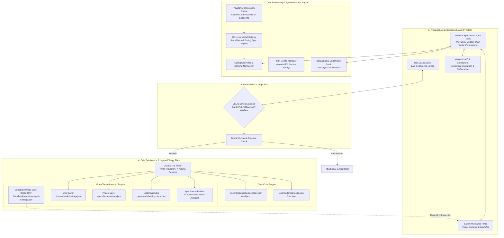

# OpenCode & OpenClaude Config Editor

[](https://github.com/yana-arch/opencode-config-editor/releases)
[](https://python.org)
[](https://pypi.org/project/PySide6/)
[](https://json-schema.org/)
[](./LICENSE)
[](https://github.com/yana-arch/opencode-config-editor/actions)

> **Enterprise-grade, multi-agent graphical configuration suite for AI coding assistants ([OpenCode](https://opencode.ai) & [OpenClaude / Claude Code](https://openclaude.gitlawb.com)). Features layered inheritance resolution, zero-leak secret masking, atomic write protection, and automated model catalog synchronization.**

---

**English** | [Bản Tiếng Việt](./README.md)

---

## 📌 Executive Summary & Problem Solved

Managing configuration files across modern AI coding agents is error-prone and insecure:
1. **JSON Fragility**: Hand-editing deeply nested JSON files frequently introduces syntax breaks, schema mismatches, and dropped configuration keys.
2. **Layer Collision & Shadowing**: Multi-tier architectures (Enterprise Policy → User → Project → Local overrides) make it nearly impossible to determine which layer defines a given setting or model route without tooling.
3. **Credential Vulnerability**: Exposing raw API keys, tokens, and authorization headers in plain text on screen risks accidental leakage during screen shares, recordings, or pair programming.
4. **Provider Desynchronization**: Manually maintaining model IDs, context windows, token limits, and baseURLs across multiple LLM providers is tedious and leads to outdated configurations.

**OpenCode Config Editor** solves these challenges by providing a robust PySide6 GUI with bidirectional schema validation, surgical JSON patching, layered inheritance inspection, live provider API discovery, and zero-exposure credential masking.

---

## 🏗️ Workflow Architecture



---

## 🚀 Key Features & Detailed Capabilities

### 🛡️ Enterprise Data Safety & Security
- **Zero-Exposure Secret Masking**: API keys, tokens, and custom HTTP headers render as obfuscated hashes (`sk-****e`). Values are decrypted into plain text only upon explicit toggle (👁).
- **Atomic File Persistence**: Configurations are serialized to an isolated temporary file and committed via atomic filesystem rename, guaranteeing zero file corruption during power interruptions or crashes.
- **Round-Trip Key Preservation**: Fields and schema objects not natively modeled by specific UI tabs are preserved byte-for-byte upon save.
- **Syntax Corruption Protection**: Refuses to overwrite files containing syntax errors, preventing accidental loss of complex configurations.
- **Secure Provider Soft-Deletion**: Deleted credentials are moved to `~/.config/opencode-config-editor/deleted-providers.json` with strict POSIX permissions (`0600`), enabling instant restore without leaving orphan keys in project files.

### 🤖 OpenCode Agent Capabilities (10 Tabs)
- **Comprehensive Tab Suite**: `General`, `Runtime`, `Agents`, `Commands`, `Providers`, `MCP Servers`, `Plugins`, `Permissions`, `TUI`, `Raw JSON`.
- **Live Provider API Fetching**:
  - Direct endpoint discovery from any OpenAI/Anthropic-compatible provider.
  - Automatic catalog matching for context window limits, output limits, and pricing metadata.
  - Granular `new` vs. `existing` model diffing with opt-in stale model synchronization.
- **Bulk Operations**: One-click enable/disable and batch editing for MCP servers and plugins.
- **Full History Stack**: 100-step undo/redo stack across all form mutations.

### ⚡ OpenClaude / Claude Code Capabilities (8 Tabs & 4 MCP Scopes)
- **Hierarchical Layer Precedence**:
  1. `Enterprise Policy` (Read-only, `/etc/claude-code/managed-settings.json` and drop-ins)
  2. `Local Overrides` (`.openclaude/settings.local.json`)
  3. `Project Scope` (`.openclaude/settings.json`)
  4. `User Defaults` (`~/.openclaude/settings.json`)
  5. `Global App State` (`~/.openclaude.json`)
- **Inheritance Placeholders**: Shows grey placeholder text indicating effective inherited values from higher layers.
- **Full 4-Scope MCP Management**: Configure MCP servers across `user`, `project` (`.mcp.json`), `local` (`projects[dict]`), and `policy` scopes.
- **Structured Lifecycle Hooks**: Visual editor for events, matchers, action types, shell commands, webhooks, prompts, and execution timeouts.
- **Permission Matrix**: Fine-grained `allow`, `deny`, and `ask` rule builder with command-line pattern support (e.g. `Bash(git *)`).

---

## 🛠️ Tech Stack & System Requirements

### Technology Stack
- **Language**: Python 3.8+
- **GUI Engine**: PySide6 (Qt 6 for Python)
- **Validation**: `jsonschema` (Draft-07 specification) with AST fallback
- **Packaging**: Custom AST-inlining bundler (`build.py`) generating single-file executables
- **Code Quality**: `ruff`, `pytest`, `pytest-cov`

### System Requirements
- **Operating System**: Linux (X11 / Wayland), macOS (11+), Windows (10/11)
- **Python Runtime**: Python 3.8, 3.9, 3.10, 3.11, 3.12, or 3.13
- **Dependencies**: `PySide6 >= 6.0.0`, `jsonschema >= 4.0.0` (optional but recommended)

---

## 📦 Installation & Setup Guide

### Method 1: Automatic Release Installer (Linux Recommended)

Installs the latest release directly to `/opt/opencode-editor/` and creates system desktop entries:

```bash
curl -fsSL https://raw.githubusercontent.com/yana-arch/opencode-config-editor/master/install.sh | sudo bash
```

Or run interactively in remote mode:
```bash
curl -fsSL -o install.sh https://raw.githubusercontent.com/yana-arch/opencode-config-editor/master/install.sh
sudo bash install.sh --remote
```

### Method 2: Local Installation from Standalone Binary

If building or downloading `opencode-config-editor.py`:
```bash
python3 build.py
sudo bash install.sh --local opencode-config-editor.py
```

### Method 3: Run Directly from Source

```bash
# Clone the repository
git clone https://github.com/yana-arch/opencode-config-editor.git
cd opencode-config-editor

# Install dependencies
pip install -r requirements.txt

# Run OpenCode editor
python3 src/app/main.py

# Or run the standalone build
python3 build.py
python3 opencode-config-editor.py
```

---

## 💻 Usage & Operation

Launch the application via terminal or desktop application launcher:

```bash
# Default (OpenCode adapter)
opencode-editor

# Switch to OpenClaude adapter via CLI flag or environment variable
opencode-editor --adapter=openclaude
CONFIG_EDITOR_ADAPTER=openclaude opencode-editor
```

### Keyboard Shortcuts

| Action | Shortcut | Description |
| :--- | :--- | :--- |
| **Open Folder / File** | <kbd>Ctrl</kbd> + <kbd>O</kbd> | Load a specific project workspace or configuration file |
| **Save Changes** | <kbd>Ctrl</kbd> + <kbd>S</kbd> | Atomically validate and commit all pending tab modifications |
| **Undo** | <kbd>Ctrl</kbd> + <kbd>Z</kbd> | Revert previous configuration edit |
| **Redo** | <kbd>Ctrl</kbd> + <kbd>Shift</kbd> + <kbd>Z</kbd> | Redo reverted configuration edit |
| **Toggle Theme** | <kbd>Ctrl</kbd> + <kbd>T</kbd> | Switch between System / Dark / Light UI theme |
| **Zoom In / Out** | <kbd>Ctrl</kbd> + <kbd>+</kbd> / <kbd>-</kbd> | Adjust UI font scale |

---

## 🗂️ Project Structure

```text
opencode-config-editor-project/
├── build.py                      # Multi-target bundling script (emits single-file executables)
├── install.sh                    # Production deployment & desktop entry installer
├── requirements.txt              # Core runtime & development dependencies
├── ruff.toml                     # Linter & style enforcement configuration
├── CHANGELOG.md / CHANGELOG_EN.md# Release history
├── CONTRIBUTING.md               # Contribution workflow
├── src/
│   ├── app/
│   │   ├── main.py               # CLI entry point and argument parsing
│   │   └── main_window.py        # Central Qt window, tab dispatcher & shortcut manager
│   ├── core/
│   │   ├── adapter.py            # Base adapter interface and adapter registry
│   │   ├── base_tab.py           # Reusable form builder and widget binder
│   │   ├── catalog.py            # Model catalog & provider metadata normalization
│   │   ├── config.py             # Layered configuration reader, dirty tracking & atomic writer
│   │   ├── config_converter.py   # Cross-format schema converter
│   │   ├── connectivity.py       # Endpoint ping and latency testing
│   │   ├── header.py             # Global constants and type contracts
│   │   ├── mcp_templates.py      # Presets for popular MCP server packages
│   │   ├── parsing.py            # JSON / JSONC fault-tolerant parser
│   │   ├── provider_fetch.py     # Background REST worker for dynamic model discovery
│   │   ├── settings.py           # Persistent GUI settings (theme, font, window bounds)
│   │   ├── widgets_catalog.py    # Visual catalog browser & filter UI
│   │   ├── widgets_common.py     # MaskedLineEdit, status chips, and badge widgets
│   │   ├── widgets_connectivity.py# Connection test modals
│   │   ├── widgets_converter.py  # Model conversion dialogs
│   │   └── widgets_mcp_hub.py    # MCP installation hub
│   └── adapters/
│       ├── opencode/             # OpenCode adapter (10 specialized tabs)
│       └── openclaude/           # OpenClaude adapter (8 layered tabs + 4 MCP scopes)
├── tests/                        # Comprehensive pytest test suite
├── opencode-config-editor.py     # Bundled standalone executable (OpenCode default)
└── openclaude-config-editor.py   # Bundled standalone executable (OpenClaude default)
```

---

## 📄 License & Attribution

This project is licensed under the **MIT License**. See [`LICENSE`](./LICENSE) for full details.

Maintained by **[yana-arch](https://github.com/yana-arch)**. Bug reports, pull requests, and feature discussions are welcomed on GitHub.
